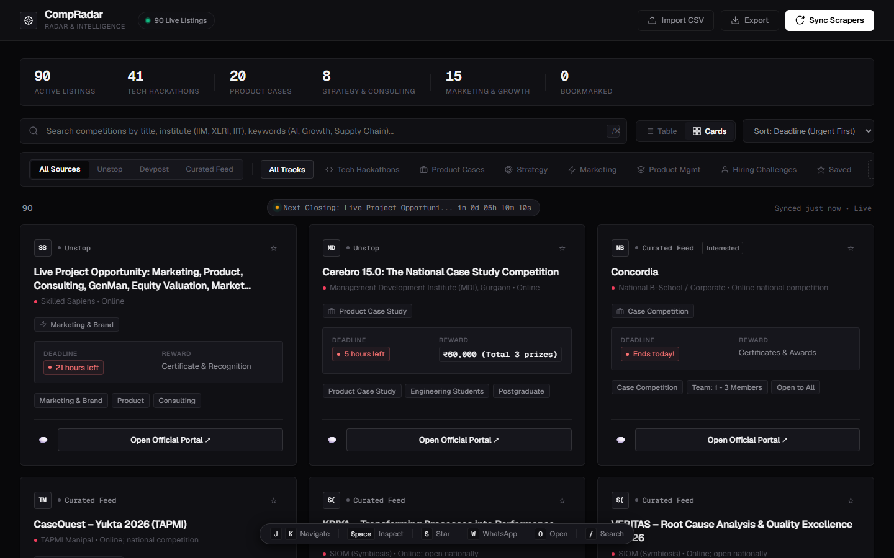

<div align="center">

# 🎯 CompRadar
### Real-Time Competition Radar & Intelligence Terminal

*A lightweight, zero-dependency intelligence terminal to scrape, filter, and track product competitions, tech hackathons, Kaggle ML bounties, Superteam Earn gigs, consulting case studies, and B-School annual fests.*

<br/>

[](https://compradar.vercel.app)
[](https://python.org)
[](https://docs.python.org/3/)
[]()
[](LICENSE)

<br/>

[](https://vercel.com/new/clone?repository-url=https%3A%2F%2Fgithub.com%2Fchirag478%2FCompRadar)
[](https://render.com/deploy?repo=https://github.com/chirag478/CompRadar)

</div>

<br/>

---

## 📸 Interface Preview

### 1. High-Density Radar Table (Active Urgency & Monograms)
> *Swiss-style precision table view with active live tickers, deadline countdowns, organizer badges, and instant keyboard navigation.*


<br/>

### 2. Precision Card Grid (Tactile Inspection)
> *Minimalist cards with organizer initials, prize pools, live status indicators, and one-click WhatsApp sharing.*



<br/>

### 3. Track Specialization (Strategy, Consulting & Marketing)
> *Dedicated tracks for B-School case challenges, consulting problem statements, and brand growth competitions.*


---

## ⚡ Core Capabilities

- **Zero-Dependency Architecture**: Runs out-of-the-box on standard Python 3 (`http.server`, `urllib.request`, `sqlite3`). No `pip install`, virtualenvs, or C-compilers required.
- **9 Live & Curated Sources (Deduplicated)**:
  - **Unstop**: Direct public API integration extracting Tech Hackathons, Product Case Studies, Strategy challenges, Brand competitions, and Hiring challenges (with automatic city & PPO/PPI detection).
  - **Devfolio**: Live Indian & Bengaluru hackathons via Devfolio's search API.
  - **Devpost**: Global open hackathons, AI/ML engineering sprints, and builder summits.
  - **HackerEarth**: Corporate coding hackathons and hiring challenges.
  - **Superteam Earn**: Live Product, Growth, Design & Engineering bounties (`USDC`).
  - **Kaggle & Premier ML Registries**: High-stakes data science challenges and machine learning prize pools ($1M+ ARC Prize, AI Math Olympiad, RSNA).
  - **Top B-School Annual Fests**: Auto-indexed flagship conclaves across IIM Ahmedabad (*TRBS*), IIM Bangalore (*Vista* & *Eximius*), IIM Calcutta (*Intaglio*), XLRI (*Ensemble-Valhalla*), FMS (*Fiesta*), SPJIMR (*Ojas*), MDI (*Imperium*), IIT Bombay (*Eureka!*), IISc (*Pravega*), SIBM Bengaluru (*Revelation*), and ISB (*Advaita*).
  - **Corporate Flagships & DrivenData**: *HUL L.I.M.E.*, *Tata Imagination*, *Flipkart WiRED*, *Amazon ACE*, *Reliance T.U.P.*, *BCG Strategy Cup*, and DrivenData ML contests.
  - **Curated Feeds & Admin-Protected CSV Ingestion**: Built-in parser and UI importer gated by `COMPRADAR_ADMIN_TOKEN` with 5-attempt brute-force lockout, 256 KB payload cap, and strict `http/https` URL validation.
- **Zero-Duplicate & PG/MBA Eligibility Filtering**:
  - Two-layer deduplication by canonical URL and normalized title across all 9 sources.
  - Automatically excludes expired competitions (`remain_days < 0` / `FINISHED`) and undergraduate-only / school-only events, keeping listings focused on MBA/PG/Open-to-All tracks.
- **Bengaluru, PPO/PPI & Shareable Filter URLs**:
  - Custom glassmorphic animated dropdowns (`Source`, `Track`, `Location`, `Sort`) + quick-preset chips (`Bengaluru`, `≤ 3 Days Left`, `High Rewards`, `PPO / PPI`, `MBA / 1st-Yr PG`).
  - `history.replaceState` syncs all active filters to the URL for 1-click sharing.
- **Light / Dark / System Theme**: Zero-FOUC `prefers-color-scheme` auto-detection with a 3-way header toggle (`System` → `Light` → `Dark`).
- **Automated Background Scraper**: Silent recurring daemon thread refreshing listings every 6 hours on persistent hosts.
- **Aggregate Prize Pool Ticker**: Dynamic real-time calculation aggregating total active rewards (**₹24.76 Cr+**) across active competitions.
- **Pre-filled WhatsApp Team Pitch**: One-click formatted team recruitment message generator with role callouts and direct registration link.
- **Progressive Web App (PWA)**: Installable on Android, iOS, and Desktop (`manifest.json`, `icon-192.png`, `icon-512.png`, network-first `sw.js`, and 1-tap header `Install` button).
- **Responsive & Performance-Optimized**: Mobile/tablet breakpoints (`<= 640px`, `<= 950px`, `<= 1120px`), `gzip` response compression, `DocumentFragment` DOM batching, `content-visibility: auto`, and delegated event handling.
- **Private Per-User Tracking**: Bookmarks and Application Stage CRM (`Not Applied` → `Interested` → `Applied` → `Shortlisted`) are stored privately in each visitor's `localStorage`.
- **Live Urgency Radar**:
  - Real-time countdown clock calculating exact time remaining (`Xd Xh Xm Xs`) for upcoming deadlines.
  - Muted visual status tags for competitions expiring in $\le$ 3 days or $\le$ 7 days.
- **Application Stage CRM**: Track personal progress for each competition:
  - `Not Applied` $\rightarrow$ `Interested` $\rightarrow$ `Applied` $\rightarrow$ `Shortlisted`.
- **Keyboard-First Navigation** (Linear / Raycast power-user hotkeys):
  - `j` / `k` or `↓` / `↑` — Navigate opportunities
  - `Space` / `Enter` — Open inspection slide-over drawer
  - `s` — Star / Bookmark
  - `w` — Copy WhatsApp-formatted summary
  - `c` — Copy direct official portal URL
  - `o` — Open official challenge portal in new tab
  - `/` — Focus search command bar
  - `?` — View keyboard shortcuts cheat sheet
  - `Esc` — Close drawer / modal
- **One-Click Exports**: Download filtered directories directly as **CSV** or **JSON**.

---

## 🚀 Quickstart

### Prerequisites
- Python 3.10 or higher installed.

### Option 1: One-Click Launch (Windows)
Double-click `run.bat` in the repository root.

### Option 2: Command Line (Windows, macOS, Linux)
```bash
# Clone the repository
git clone https://github.com/chirag478/CompRadar.git
cd CompRadar

# Launch the server (Zero pip install needed!)
python server.py
```

Open your browser at:
👉 **[http://localhost:5000](http://localhost:5000)**

---

## 🔌 REST API Endpoints

CompRadar exposes a built-in REST API:

| Endpoint | Method | Description |
| :--- | :--- | :--- |
| `/api/opportunities` | `GET` | Query opportunities (`source`, `category`, `query`, `location`, `sort`, `urgent`, `high_prize`, `ppo`, `mba_1st`) |
| `/api/stats` | `GET` | Returns active counts across categories and total prize pool |
| `/api/scrape` | `POST` | Triggers concurrent scrapers across all 9 sources (30s per-IP cooldown) |
| `/api/import-csv` | `POST` | Admin-protected CSV ingestion (`COMPRADAR_ADMIN_TOKEN`, 5-attempt lockout, 256 KB cap) |
| `/api/export` | `GET` | Downloads current filtered selection as `.csv` or `.json` |

---

## 📁 Repository Structure

```
compradar/
├── api/
│   └── index.py              # Vercel Python Serverless entrypoint
├── assets/
│   └── screenshots/          # Application walkthrough previews
│       ├── compradar-table.png
│       ├── compradar-cards.png
│       └── compradar-strategy.png
├── data/
│   └── curated_competitions.csv  # Seeded B-School case competitions dataset
├── scrapers/
│   ├── aggregator.py         # Concurrent 9-source coordinator & deduplicator
│   ├── bschool_fests.py      # Premier B-School flagship fest indexer
│   ├── corporate_flagships.py # Corporate case flagships & DrivenData ML
│   ├── curated.py            # Local CSV feed scraper & XSS-safe parser
│   ├── devfolio.py           # Devfolio live hackathon API scraper
│   ├── devpost.py            # Devpost public API scraper
│   ├── hackerearth.py        # HackerEarth challenges & hiring scraper
│   ├── kaggle.py             # Kaggle & ML competitions scraper
│   ├── superteam.py          # Superteam Earn Product/Growth/Dev bounties
│   └── unstop.py             # Unstop challenge & case competition scraper
├── static/
│   ├── app.js                # Reactive UI, URL sync, theme & PWA install
│   ├── icon-192.png          # PWA home-screen icon (192x192)
│   ├── icon-512.png          # PWA splash/maskable icon (512x512)
│   ├── index.html            # Zero-FOUC responsive desktop & mobile layout
│   ├── manifest.json         # PWA Web App Manifest
│   ├── sw.js                 # Network-first PWA Service Worker
│   └── style.css             # Monochrome Swiss Light/Dark design system
├── database.py               # SQLite persistence, dedup, /tmp fallback & prize math
├── Dockerfile                # Lightweight container build (Python Alpine)
├── render.yaml               # 1-click Render blueprint specification
├── railway.json              # Railway deploy configuration
├── vercel.json               # Vercel serverless & static asset routing
├── Procfile                  # Heroku / Dokku / Railway process descriptor
├── run.bat                   # Windows launcher script
├── server.py                 # Multi-threaded HTTP server with gzip & rate limits
└── README.md
```

---

## ☁️ 1-Click Free Cloud Hosting

CompRadar is zero-dependency, serverless-ready, and container-ready:

### Option 1: Deploy to Vercel (Live at `compradar.vercel.app`)
[](https://vercel.com/new/clone?repository-url=https%3A%2F%2Fgithub.com%2Fchirag478%2FCompRadar)

1. Click **Deploy with Vercel** above (uses [`vercel.json`](vercel.json) and [`api/index.py`](api/index.py)).
2. *(Optional)* Set `COMPRADAR_ADMIN_TOKEN` in **Environment Variables** to enable admin CSV imports.

### Option 2: Deploy to Render (Free `*.onrender.com` Subdomain)
[](https://render.com/deploy?repo=https://github.com/chirag478/CompRadar)

1. Click **Deploy to Render** above (reads [`render.yaml`](render.yaml) automatically).
2. Sign in with GitHub, confirm the service name (`compradar`), and click **Apply**.
3. Your live instance will be available at `https://compradar.onrender.com` with automatic HTTPS and auto-deploys on push.

### Option 2: Railway / Koyeb
- **Railway**: Connect `chirag478/CompRadar` on [railway.app](https://railway.app) (uses [`railway.json`](railway.json) and [`Procfile`](Procfile)) and generate a free `*.up.railway.app` domain.
- **Koyeb**: Deploy directly from GitHub using the included [`Dockerfile`](Dockerfile) for a free `*.koyeb.app` URL.

### Option 3: Local / Self-Hosted Docker
```bash
docker build -t compradar .
docker run -p 5000:5000 compradar
```

---

## 📜 License

Distributed under the MIT License. See `LICENSE` for details.
