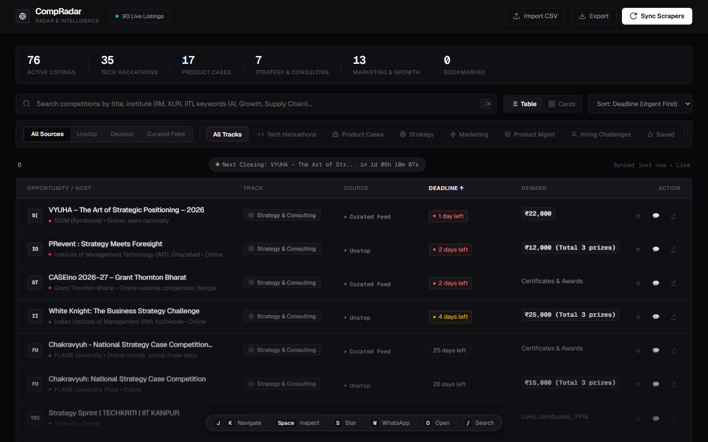

<div align="center">

# 🎯 CompRadar
### Real-Time Competition Radar & Intelligence Terminal

*A lightweight, zero-dependency intelligence terminal to scrape, filter, and track product competitions, tech hackathons, consulting case studies, and marketing challenges from Unstop, Devpost, and curated B-School feeds.*

<br/>

[](https://python.org)
[](https://docs.python.org/3/)
[](LICENSE)
[]()

</div>

<br/>

---

## 📸 Interface Preview

### 1. High-Density Radar Table (Active Urgency & Monograms)
> *Swiss-style precision table view with active live tickers, deadline countdowns, organizer badges, and instant keyboard navigation.*


<br/>

### 2. Precision Card Grid (Tactile Inspection)
> *Minimalist cards with organizer initials, prize pools, live status indicators, and one-click WhatsApp sharing.*


<br/>

### 3. Track Specialization (Strategy, Consulting & Marketing)
> *Dedicated tracks for B-School case challenges, consulting problem statements, and brand growth competitions.*



---

## ⚡ Core Capabilities

- **Zero-Dependency Architecture**: Runs out-of-the-box on standard Python 3 (`http.server`, `urllib.request`, `sqlite3`). No `pip install`, virtualenvs, or C-compilers required.
- **Multi-Source Scraping & Indexing**:
  - **Unstop**: Direct public API integration extracting Tech Hackathons, Product Case Studies, Strategy challenges, Brand competitions, and Hiring challenges.
  - **Devpost**: Global open hackathons, AI/ML engineering sprints, and builder summits.
  - **Kaggle & Premier ML Registries**: High-stakes data science challenges and machine learning prize pools ($1M+ ARC Prize, AI Math Olympiad, RSNA).
  - **Top B-School Annual Fests**: Auto-indexed flagship conclaves across IIM Ahmedabad (*TRBS*), IIM Bangalore (*Vista*), IIM Calcutta (*Intaglio*), XLRI (*Ensemble-Valhalla*), FMS (*Fiesta*), SPJIMR (*Ojas*), MDI (*Imperium*), IIT Bombay (*Eureka!*), and ISB (*Advaita*).
  - **Curated Feeds & CSV Ingestion**: Built-in parser and UI importer for private college spreadsheets (IIMs, XLRI, IITs, corporate case books).
- **Automated Background Scraper**: Silent recurring daemon thread refreshing listings every 6 hours without blocking the user or needing manual intervention.
- **Aggregate Prize Pool Ticker**: Dynamic real-time calculation aggregating total active rewards (₹4.2 Cr+ / $2M+) across active competitions.
- **Pre-filled WhatsApp Team Pitch**: One-click formatted team recruitment message generator with role callouts and direct registration link.
- **Progressive Web App (PWA)**: Installable on iOS, Android, and Desktop (`manifest.json` & `sw.js`) with offline shell caching.
- **Strict Active Filter**: Automatically excludes competitions whose deadlines have passed (`remain_days < 0` or status `FINISHED`).
- **Live Urgency Radar**:
  - Real-time countdown clock calculating exact time remaining (`Xd Xh Xm Xs`) for upcoming deadlines.
  - Muted visual status tags for competitions expiring in $\le$ 3 days or $\le$ 7 days.
- **Application Stage CRM**: Track personal progress for each competition:
  - `Not Applied` $\rightarrow$ `Interested` $\rightarrow$ `Applied` $\rightarrow$ `Shortlisted`.
- **Keyboard-First Navigation** (Linear / Raycast power-user hotkeys):
  - `j` / `k` or `↓` / `↑` — Navigate opportunities
  - `Space` / `Enter` — Open inspection slide-over drawer
  - `s` — Star / Bookmark
  - `w` — Copy WhatsApp-formatted summary
  - `c` — Copy direct official portal URL
  - `o` — Open official challenge portal in new tab
  - `/` — Focus search command bar
  - `?` — View keyboard shortcuts cheat sheet
  - `Esc` — Close drawer / modal
- **One-Click Exports**: Download filtered directories directly as **CSV** or **JSON**.

---

## 🚀 Quickstart

### Prerequisites
- Python 3.10 or higher installed.

### Option 1: One-Click Launch (Windows)
Double-click `run.bat` in the repository root.

### Option 2: Command Line (Windows, macOS, Linux)
```bash
# Clone the repository
git clone https://github.com/chirag478/CompRadar.git
cd CompRadar

# Launch the server (Zero pip install needed!)
python server.py
```

Open your browser at:
👉 **[http://localhost:5000](http://localhost:5000)**

---

## 🔌 REST API Endpoints

CompRadar exposes a built-in REST API:

| Endpoint | Method | Description |
| :--- | :--- | :--- |
| `/api/opportunities` | `GET` | Query opportunities with filters (`source`, `category`, `q`, `sort`, `bookmarked`, `urgent`, `high_prize`) |
| `/api/stats` | `GET` | Returns active counts across categories and bookmark totals |
| `/api/scrape` | `POST` | Triggers concurrent scrapers across Unstop, Devpost, and local feeds |
| `/api/bookmark` | `POST` | Toggles bookmark status for a listing (`{ "id": "..." }`) |
| `/api/status` | `POST` | Updates CRM application stage (`{ "id": "...", "status": "Applied" }`) |
| `/api/import-csv` | `POST` | Ingests raw CSV or pasted competition tables into SQLite cache |
| `/api/export` | `GET` | Downloads current filtered selection as `.csv` or `.json` |

---

## 📁 Repository Structure

```
compradar/
├── assets/
│   └── screenshots/          # Application walkthrough previews
│       ├── compradar-table.png
│       ├── compradar-cards.png
│       └── compradar-strategy.png
├── data/
│   └── curated_competitions.csv  # Seeded B-School case competitions dataset
├── scrapers/
│   ├── aggregator.py         # Concurrent multi-threaded scraping coordinator
│   ├── bschool_fests.py      # Premier B-School flagship fest indexer
│   ├── curated.py            # Local CSV feed scraper & parser
│   ├── devpost.py            # Devpost public API scraper
│   ├── kaggle.py             # Kaggle & ML competitions scraper
│   └── unstop.py             # Unstop challenge & case competition scraper
├── static/
│   ├── app.js                # Reactive UI engine with keyboard navigation & tickers
│   ├── index.html            # High-density desktop & mobile layout
│   ├── manifest.json         # PWA Web App Manifest
│   ├── sw.js                 # PWA Service Worker (offline shell cache)
│   └── style.css             # Monochrome Swiss design system
├── database.py               # SQLite persistence, prize pool math & caching layer
├── Dockerfile                # Lightweight container build (Python Alpine)
├── render.yaml               # 1-click Render blueprint specification
├── railway.json              # Railway deploy configuration
├── Procfile                  # Heroku / Dokku / Railway process descriptor
├── run.bat                   # Windows launcher script
├── server.py                 # Multi-threaded Python HTTP REST API server
└── README.md
```

---

## ☁️ 1-Click Cloud Deployment

CompRadar is zero-dependency and container-ready with dynamic `$PORT` binding:

### Deploy to Render
1. Fork or push this repository to your GitHub account.
2. In [Render Dashboard](https://dashboard.render.com/), choose **New Blueprint Instance** and point to your repository (`render.yaml`).
3. Deploy is automatic with zero configuration.

### Deploy with Docker
```bash
docker build -t compradar .
docker run -p 5000:5000 compradar
```

---

## 📜 License

Distributed under the MIT License. See `LICENSE` for details.
